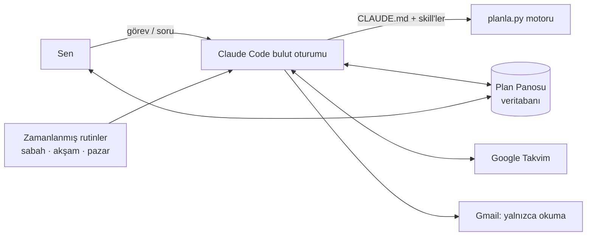

# Planlama Asistanı: Kullanım Kılavuzu

Bulutta çalışan kişisel planlama asistanın. Bir iş verirsin. Asistan işi
analiz eder, eksik bilgiyi sorar, gerçekçi bir süre biçer, yetişip
yetişmeyeceğini hesaplar ve onayınla takvimine yerleştirir. Sabah, akşam ve
pazar günleri senin yerine kendiliğinden çalışır.

## Nasıl kullanılır

**Telefondan hızlıca: Plan Panosu**
[Plan Panosu](https://claude.ai/artifact/6VdKq43bCHR286qTh73DRV)'nu ana ekrana
ekle. Panoda şunları yapabilirsin:
- **Bugün**: günün zaman bloklarını ve en önemli 3 işini gör.
- **Hızlı ekle**: aklına geleni yaz. Görev gelen kutusuna düşer.
- **Claude yorumlasın**: Claude görevi orada analiz eder, sorularını sorar,
  süre ve önem önerir.
- **Bitti**: işi kapat ve gerçek süresini gir. Asistan bununla tahminlerini
  senin hızına göre düzeltir.
- **Öncelikler ve son tarih kontrolü**: neyin neden önde olduğunu ve hangi
  teslimin risk altında olduğunu gör.

**Ayrıntılı işler için: Claude Code (claude.ai/code)**
Bu repoyla bir oturum aç ve yaz:

| Komut | Ne yapar |
|---|---|
| `/kurulum` | İlk iş. Çalışma saatlerini, ders programını ve verimli saatlerini öğrenir. |
| `/gorev Mukavemet ödevi cuma teslim` | İşi analiz eder, soru sorar, böler, planlar, takvime ekler. |
| `/gunluk-plan` | Günün zaman bloklu planını çıkarır. |
| `/gun-sonu` | Biteni ve kalanı kaydeder, yarını hazırlar. |
| `/haftalik-plan` | Haftalık gözden geçirme ve haftanın 3 hedefi. |
| `/proje-plani` | Sınav, rapor, yarışma gibi büyük hedefleri geriye doğru planlar. |
| `/takvim` | Takvime ekler, taşır ya da listeler. |
| `/eposta-tara` | Gmail'den görev ve son tarih çıkarır. |

Komut yazmak zorunda değilsin. "Cuma 17:00'ye kadar şasi raporunu bitirmem
lazım" demen yeter; asistan doğru akışı seçer.

## Nasıl çalışır



- **Beyin:** Claude Code bulut oturumu. Kurallar `CLAUDE.md`'de, iş akışları
  `.claude/skills/`'te.
- **Hafıza:** Plan Panosu'nun veritabanı. Görevler, planlar ve profil burada
  tutulur. Her oturum ve her rutin aynı veriyi görür.
- **Hesap:** `planla.py`. Öncelik puanını, son tarih fizibilitesini (EDF) ve
  zaman bloklarını hesaplar. Claude bu sonuçları yorumlar.
- **Güvenlik:** hook'lar takvimden silme ve e-posta gönderme öncesinde onay
  ister. Asistan her mesajda İstanbul saatini bilir.
- **Gerekçe:** her kural bir araştırmaya dayanır. Bkz. [yontemler.md](yontemler.md).

## Öncelik puanı nasıl hesaplanır

```
skor = 50 × (önem − 1)/4  +  50 × (aciliyet − 1)/4  +  bekletilen iş bonusu  +  gecikme bonusu
```

- **Önem** (1–5) sana sorulur.
- **Aciliyet** (1–5) hesaplanır. Son tarihe kadarki çalışma kapasiten, kalan
  işe (tahmin × kişisel katsayı) bölünür:
  - oran < 1 ise **yetişmez** (5)
  - oran < 1,5 ise 4
  - oran < 3 ise 3
  - oran < 6 ise 2
  - diğer durumlarda 1
- Bir iş tek başına yetişse bile, diğer son tarihli işlerle birlikte
  yetişmiyorsa aciliyeti en az 4 olur.
- **Kadranlar:** önem ≥ 4 ise "önemli", aciliyet ≥ 4 ise "acil" sayılır.

## Geliştirici notları

```bash
python3 -m unittest planlayici/test_planla.py -v   # motor testleri
python3 planlayici/planla.py --help
```

Pano kaynağı `planlayici/pano/index.html`. Değişirse aynı URL'ye yeniden
yayımlanır.
