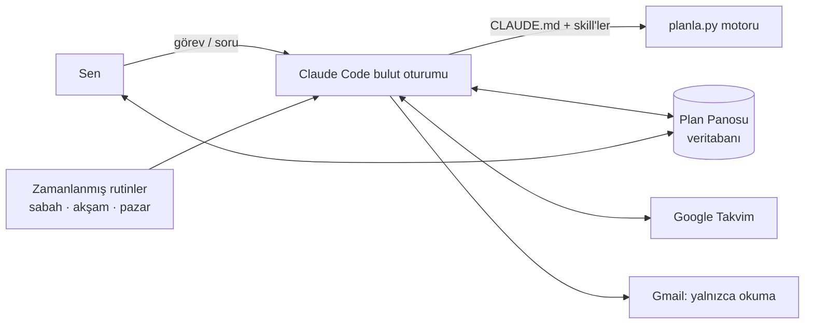

# Planlama Asistanı: Kullanım Kılavuzu

Bulutta çalışan kişisel planlama asistanın. Bir iş verirsin. Asistan işi
analiz eder, eksik bilgiyi sorar, gerçekçi bir süre biçer, yetişip
yetişmeyeceğini hesaplar ve onayınla takvimine yerleştirir. Sabah, akşam ve
pazar günleri senin yerine kendiliğinden çalışır.

## Nasıl kullanılır

**Telefondan hızlıca: Plan Panosu**
[Plan Panosu](https://claude.ai/artifact/6VdKq43bCHR286qTh73DRV)'nu ana ekrana
ekle. Panoda şunları yapabilirsin:
- **Bugün**: günün zaman bloklarını ve en önemli 3 işini gör.
- **Hızlı ekle**: aklına geleni yaz. Görev gelen kutusuna düşer.
- **Claude yorumlasın**: Claude görevi orada analiz eder, sorularını sorar,
  süre ve önem önerir.
- **Bitti**: işi kapat ve gerçek süresini gir. Asistan bununla tahminlerini
  senin hızına göre düzeltir.
- **Öncelikler ve son tarih kontrolü**: neyin neden önde olduğunu ve hangi
  teslimin risk altında olduğunu gör.

**Ayrıntılı işler için: Claude Code (claude.ai/code)**
Bu repoyla bir oturum aç ve yaz:

| Komut | Ne yapar |
|---|---|
| `/kurulum` | İlk iş. Çalışma saatlerini, ders programını ve verimli saatlerini öğrenir. |
| `/gorev Mukavemet ödevi cuma teslim` | İşi analiz eder, soru sorar, böler, planlar, takvime ekler. |
| `/gunluk-plan` | Günün zaman bloklu planını çıkarır. |
| `/gun-sonu` | Biteni ve kalanı kaydeder, yarını hazırlar. |
| `/haftalik-plan` | Haftalık gözden geçirme ve haftanın 3 hedefi. |
| `/proje-plani` | Sınav, rapor, yarışma gibi büyük hedefleri geriye doğru planlar. |
| `/takvim` | Takvime ekler, taşır ya da listeler. |
| `/eposta-tara` | Gmail'den görev ve son tarih çıkarır. |
| `/calis solidworks` (ya da `yz`, `almanca`, `borsa`) | O izdeki bugünkü oturumu hazırlar: kaynak linki, dakika dakika akış, alıştırma. Bitince AI özeti verir ve ilerlemeyi kaydeder. |
| `/ders MEC.MAT` + not/fotoğraf | Ders notunu özetler; formüller, 5 test sorusu ve çözümlü örnek üretir; 1-3-7 gün tekrarlarını kurar. |
| `/borsa` | Akşam 30 dakikalık BIST araştırma rutini ve işlem günlüğü. Hisse önerisi vermez. |

Komut yazmak zorunda değilsin. "Cuma 17:00'ye kadar şasi raporunu bitirmem
lazım" demen yeter; asistan doğru akışı seçer.

## Öğrenme izleri ve haftalık iskelet

Öncelik sırası: **1) dersler, Solar Team, SolidWorks → 2) yapay zekâ →
3) Almanca → 4) borsa.** Zaman çakışırsa üstteki kazanır.

| İz | Ne zaman | Haftalık hedef | Müfredat |
|---|---|---|---|
| Ders tekrarı | Ders günlerinin akşamı (Pzt, Sal 17:00 · Çar 16:30 · Cum 17:20) | 195 dk | [dersler.md](izler/dersler.md) |
| SolidWorks | Pzt, Sal, Per 14:00 · Cum 20:00 (13–18 Ekim haftası: 7,5 saat) | 200 dk | [solidworks.md](izler/solidworks.md) |
| Yapay zekâ | Sal 20:00 · Per 09:00 · Paz 15:00 | 150 dk | [yapay-zeka.md](izler/yapay-zeka.md) |
| Almanca | Her gün 21:30 (Per 21:10) + ölü zamanlarda uygulama | 175 dk | [almanca.md](izler/almanca.md) |
| Borsa | Paz–Per 23:00–23:30 | 150 dk | [borsa.md](izler/borsa.md) |

- Panodaki **Öğrenme izleri** bölümünde her izin haftalık ilerlemesi
  görünür. "+N dk çalıştım" ile telefondan kayıt girersin.
- **Sınav haftası modu:** profilde `sinav_donemleri`'ne bir vize haftası
  girildiğinde Almanca ve borsa blokları düşer, yapay zekâ haftada 1
  oturuma iner. `/ders` ile vize tarihini verince bu mod kendiliğinden kurulur.
- Almanca ve borsa "hafif" işler sayılır ve günlük 3,5 saatlik odak
  kapasitesinden düşülmez. Diğer izler düşülür.

## Otomatik rutinler

Bulutta, sen bir şey yapmadan çalışırlar ve sonucu telefonuna bildirim olarak
gönderirler (claude.ai → Routines):

| Rutin | Ne zaman | Ne yapar |
|---|---|---|
| Sabah Planı | Her gün 07:45 | Günün zaman bloklu planını panoya yazar, en önemli 3 işi bildirir |
| Gün Sonu | Her gün 22:22 | Açık kalan işleri listeler, yarının taslak planını hazırlar |
| Haftalık Plan | Pazar 20:47 | 14 günlük son tarih kontrolü, haftanın 3 hedef önerisi, pazartesi planı |

Rutinler kullanıcı yokken çalıştığı için soru sormaz ve takvimden bir şey
silmez. Takvime yalnızca profilde `takvim_yazma: "otomatik"` seçiliyse yazar.
Saatleri claude.ai'daki Routines sayfasından değiştirebilirsin. İstersen
asistandan da değiştirmesini isteyebilirsin.

## Bağlayıcılar

- **Gmail**: bağlı. `/eposta-tara` e-postadan görev çıkarmak için kullanır.
  Yalnızca okur; gönderme ve silme işlemleri onaya bağlıdır.
- **Google Takvim**: henüz bağlı değil. claude.ai → Ayarlar → Bağlayıcılar →
  Google Calendar yolundan bağla. Bağlanmadan önce asistan .ics dosyası
  üretir.
- Rutinler bağlayıcı olmadan oluşturuldu. Takvimi bağladıktan sonra
  rutinlerin takvime erişmesi için Routines sayfasında her rutine Google
  Calendar'ı ekle. İstersen asistandan bunu yeniden kurmasını da
  isteyebilirsin.

## Nasıl çalışır



- **Beyin:** Claude Code bulut oturumu. Kurallar `CLAUDE.md`'de, iş akışları
  `.claude/skills/`'te.
- **Hafıza:** Plan Panosu'nun veritabanı. Görevler, planlar ve profil burada
  tutulur. Her oturum ve her rutin aynı veriyi görür.
- **Hesap:** `planla.py`. Öncelik puanını, son tarih fizibilitesini (EDF) ve
  zaman bloklarını hesaplar. Claude bu sonuçları yorumlar.
- **Güvenlik:** hook'lar takvimden silme ve e-posta gönderme öncesinde onay
  ister. Asistan her mesajda İstanbul saatini bilir.
- **Gerekçe:** her kural bir araştırmaya dayanır. Bkz. [yontemler.md](yontemler.md).

## Öncelik puanı nasıl hesaplanır

```
skor = 50 × (önem − 1)/4  +  50 × (aciliyet − 1)/4  +  bekletilen iş bonusu  +  gecikme bonusu
```

- **Önem** (1–5) sana sorulur.
- **Aciliyet** (1–5) hesaplanır. Son tarihe kadarki çalışma kapasiten, kalan
  işe (tahmin × kişisel katsayı) bölünür:
  - oran < 1 ise **yetişmez** (5)
  - oran < 1,5 ise 4
  - oran < 3 ise 3
  - oran < 6 ise 2
  - diğer durumlarda 1
- Bir iş tek başına yetişse bile, diğer son tarihli işlerle birlikte
  yetişmiyorsa aciliyeti en az 4 olur.
- **Kadranlar:** önem ≥ 4 ise "önemli", aciliyet ≥ 4 ise "acil" sayılır.

## Geliştirici notları

```bash
python3 -m unittest planlayici/test_planla.py -v   # motor testleri
python3 planlayici/planla.py --help
```

Pano kaynağı `planlayici/pano/index.html`. Değişirse aynı URL'ye yeniden
yayımlanır.
